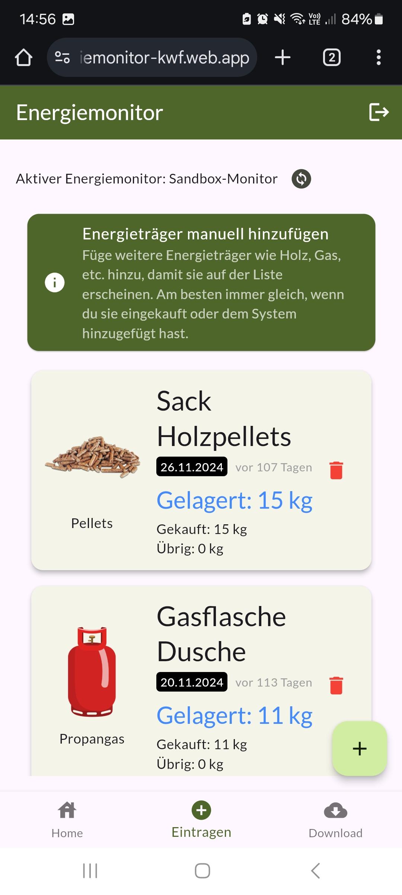
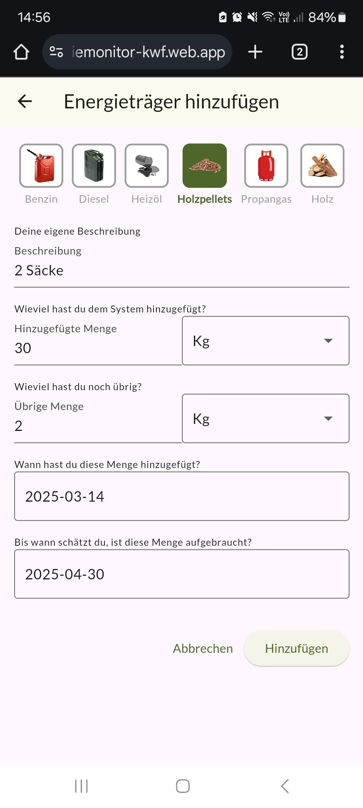

# Energiemonitor-App

**Status:** produktiv im Langzeittest. Live: [energiemonitor-kwf.web.app](https://energiemonitor-kwf.web.app/)

Web-App für den [KWF Energiemonitor](https://github.com/Verein-Kleinwohnformen/energiemonitor-docs), einem offenen Messsystem für Kleinwohnformen. Gebaut für die Energiestudie mit der HSLU und für den [Verein Kleinwohnformen](https://kleinwohnformen.ch). Der Energiemonitor ist kein Produkt, sondern eine offene Plattform zum Nachbauen.

Wenn du für die Energiestudie einen Monitor baust, nutzt du diese App unter der Adresse oben (Variante A). Nach der Freischaltung durch das Team siehst du dort deine Messpunkte. Mehr dazu in der [Doku](https://github.com/Verein-Kleinwohnformen/energiemonitor-docs/blob/main/docs/variante-a-mitmachen.md).

 

## Funktionen

- Login und Auswahl des aktiven Monitors
- Messpunkt-Karten mit Online-/Offline-Status, Kategoriefarben und aufklappbaren Sensoren mit Werten
- Diagramme mit Zoom, Verschieben und frei wählbarem Zeitbereich
- Manuelle Energieträger erfassen (Holz in Ster oder kg, Pellets, Propan, Heizöl, Diesel, Benzin) mit Kaufdatum und Restmenge
- Daten-Download als XLSX über die [API](https://github.com/Verein-Kleinwohnformen/energiemonitor-api), maximal 31 Tage
- Impressum

**Noch nicht umgesetzt:** Energiebilanz und Verbrauchsstatistik, Spartipps, Plausibilitätschecks mit Warnungen.

## Selbst bauen und hosten (Variante B)

Technik: Flutter (Dart `^3.5.3`), Firebase Auth, Firestore, Firebase Hosting. Die vollständige Anleitung steht in der [Doku zu Variante B](https://github.com/Verein-Kleinwohnformen/energiemonitor-docs/blob/main/docs/variante-b-selbst-hosten.md). Kurzfassung:

1. [Flutter](https://docs.flutter.dev/get-started/install) installieren und Repo klonen.
2. Eigenes Firebase-Projekt anlegen, Authentication (E-Mail/Passwort) und Firestore aktivieren.
3. Eigene Firebase-Konfiguration erzeugen: `flutterfire configure`. Das ersetzt [`lib/firebase_options.dart`](lib/firebase_options.dart) und die Projekt-ID in `.firebaserc` und `firebase.json`.
4. Die API-Basis-URL in [`lib/data_export.dart`](lib/data_export.dart) auf deine eigene [API](https://github.com/Verein-Kleinwohnformen/energiemonitor-api) ändern.
5. Rules und Indizes deployen: `firebase deploy --only firestore`.
6. Bauen und deployen: `flutter build web`, dann `firebase deploy --only hosting`.

### Sicherheit

- Die Firebase-Web-Konfiguration in `lib/firebase_options.dart` ist **kein Geheimnis**, sondern wird mit jeder Web-App ausgeliefert. Der Schutz liegt in den [Firestore-Rules](firestore.rules) und in den Einschränkungen des API-Schlüssels (HTTP-Referrer und benötigte APIs) in der Google Cloud Console. Setze beides für dein eigenes Projekt.
- Die Rules erlauben Usern **nicht**, ihre eigenen Zugriffe (`monitor_read`, `monitor_edit`, `monitor_api_keys`) zu ändern. Neue Monitore und Rechte vergibst du in der Firebase Console oder per Admin SDK. Teste Änderungen an den Rules im [Firestore-Emulator](https://firebase.google.com/docs/emulator-suite).
- Device-Keys der API gehören nie ins Repo.

### Cloud Functions

Der Ordner `functions/` enthält nur die leere Firebase-Vorlage und wird nicht verwendet. Ein lokales `venv` dort ist per `.gitignore` ausgeschlossen.

## Weitere Repos

[Einstieg und Doku](https://github.com/Verein-Kleinwohnformen/energiemonitor-docs) · [Container](https://github.com/Verein-Kleinwohnformen/energiemonitor-balena-nodered) · [Connector](https://github.com/Verein-Kleinwohnformen/kwf-energiemonitor-db) · [API](https://github.com/Verein-Kleinwohnformen/energiemonitor-api)

## Lizenz

Apache License 2.0, siehe [LICENSE](LICENSE). Fragen: [energiemonitor@kleinwohnformen.ch](mailto:energiemonitor@kleinwohnformen.ch)
