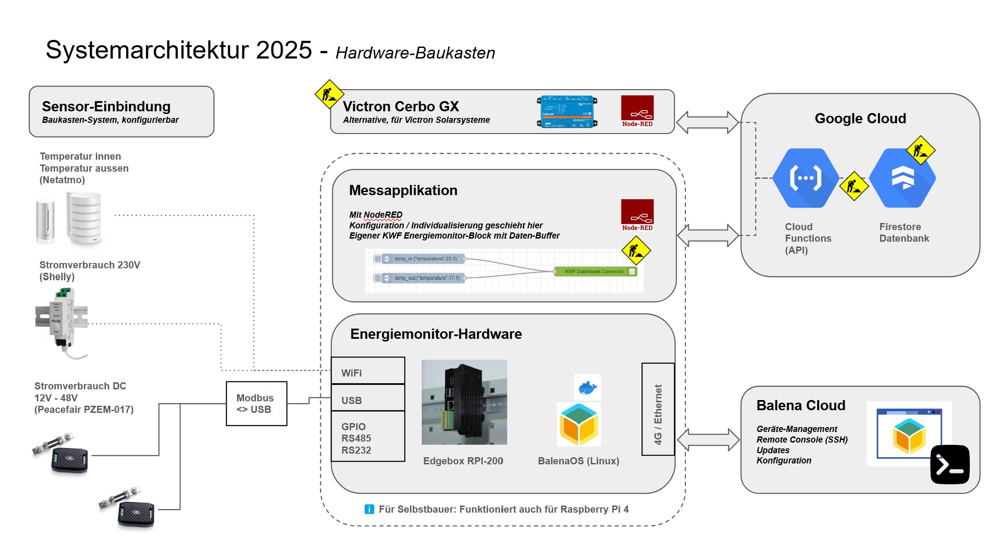
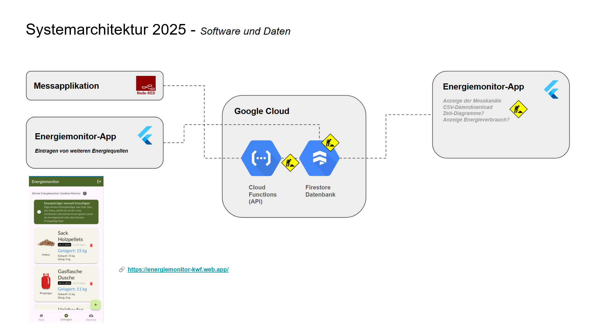
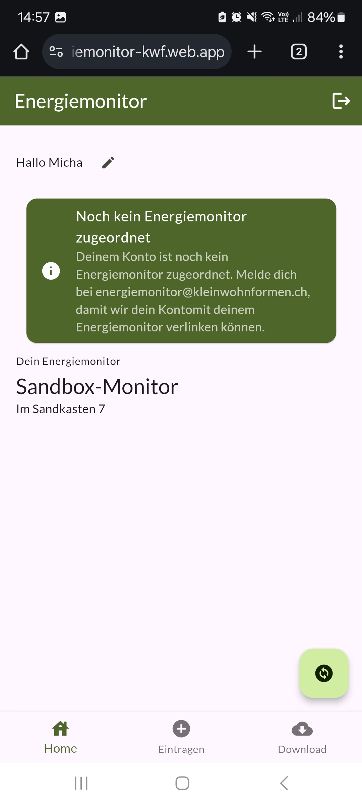

# Das Projekt Energiemonitor
Dieses Projekt soll es dir ermöglichen, deinen Energieverbrauch zu messen, in Echtzeit zu analysieren, zu verstehen und zu optimieren - mit dem Ziel dass du mit den einfachen aber richtigen Aktionen im Alltag 20% deines Energieverbrauchs einsparen kannst. Dieses Projekt wird vom [Verein Kleinwohnformen](https://kleinwohnformen.ch) getragen und ist in erster Linie auf kleine, unabhängige Wohnformen zugeschnitten. Es ist aber nicht ausgeschlossen, dass du unseren Monitor auch für deine Wohnung bauen und nutzen kannst - wir sind Open Source und Mitmachen im Projekt ist erwünscht! Einfach melden beim [Energiemonitor-Team](mailto:energiemonitor@kleinwohnformen.ch).

## Projekt-Repos
- [Referenz-HW und Provisionierung mit BalenaOS](https://github.com/Verein-Kleinwohnformen/energiemonitor-balena-nodered)
- [NodeRED-Connector neu](https://github.com/Verein-Kleinwohnformen/kwf-energiemonitor-db)
- [NodeRED Beispiel-Flows (depr.)](https://github.com/Verein-Kleinwohnformen/energiemonitor-nodered-flows)
- [Energiemonitor-App (Repo)](https://github.com/Verein-Kleinwohnformen/energiemonitor-app)
- [Energiemonitor-App (Demo)](https://energiemonitor-kwf.web.app/)

## Angestrebte Architektur
Wir befinden uns noch in der Designphase, viele der eingezeichneten Komponenten existieren noch nicht. Wir streben aber das folgende System an:

# Energiemonitor-App
Diese App soll einmal die Interaktion mit dem Energiemonitor-Benutzer abbilden. Mögliche Features:
- Überprüfen der angeschlossenen Messkanälen, funktionieren alle Sensoren?
- Download der eigenen Daten über eine bestimmte Zeitspanne
- Anzeige der Live-Daten (Temperatur, CO2)
- Energieverbrauch-Statistiken, Vorschläge zur Reduktion, etc

## Aktuell implementierte Features
Im Moment dient die App lediglich dazu, zusätzliche Energiequellen wie Holz und Gas zu erfassen.

